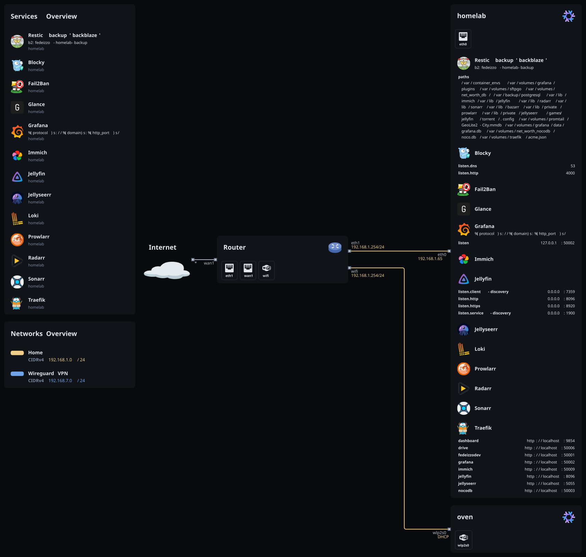
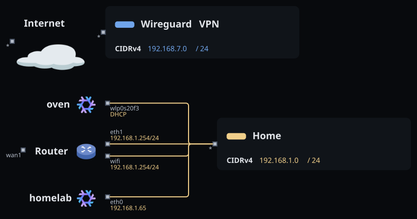

# Nix dotfiles

## Devices

- Homelab: Dell XPS 9510
- Personal laptop: Thinkpad X1 Nano
- Work laptop: Macbook pro M1 Max
- Backup homelab (inactive): Raspberry pi 4th gen

## Topology




## Repository structure
-  [home](home/): home manager configurations.
- 󰍹 [hosts](hosts/): host system configurations.
- 󱄅 [nix](nix/): flake modules.
- 󱧘 [overlays](overlays/): package overlays.
-  [scripts](scripts/): system management scripts.
-  [secrets](secrets/): secrets.

## Usage
You can use [direnv](https://direnv.net/) to easily manage the flake contained in the repository.

After executing `direnv allow`, you should have a shell powered by [devshell](https://numtide.github.io/devshell/) and by running `menu` you have an help message.

```sh
menu
```

```
  [[general commands]]

    menu                             - prints this menu

  [ System installation]

    erase-disk-and-install-raspberry -  Raspberry Pi4 8Gb.
    erase-disk-and-install-x1.       -  Thinkpad X1 Nano 6th generation.
    erase-disk-and-install-xps       -  Dell XPS 9510.

  [ System administration]

    clean                            -  Delete old generations and clean nix store.
    deploy-homelab                   -  Deploy the homelab configuration over ssh.
    plasma-manager                   -  Print the current plasma configuration.
    refresh                          -  Refresh the devshell.
    secrets                          -  Edit secrets.
    update                           -  Update the system configuration using the current flake and hostname.
    update-input                     -  Update a flake.nix input.

  [ Repository administration]

    topology                         -  Generate topology image
```

## System installation
The following instructions are valid for all machines except the Macbook pro.

In my personal laptops the disk is erased at every boot in order to obtain a complete immutable and declarative system. This is achieved using a BTRFS snapshot.

Obviously some data, logs, cache, etc. must survive the boot process, this is achieved using [impermanence](https://github.com/nix-community/impermanence).

Some useful readings:
- [erase with btrfs snapshot](https://mt-caret.github.io/blog/posts/2020-06-29-optin-state.html)
- [erase with zfs](https://grahamc.com/blog/erase-your-darlings)
- [erase with tmpfs](https://elis.nu/blog/2020/05/nixos-tmpfs-as-root/)
- [erase home](https://elis.nu/blog/2020/06/nixos-tmpfs-as-home/)

```sh
passwd root
su
git clone https://github.com/fedeizzo/nix-dotfiles.git
cd nix-dotfiles
nix develop
erase-disk-and-install-{machine}
```

### Remote installation with nixos-anywhere
[nixos-anywhere](https://github.com/nix-community/nixos-anywhere) installs a host over SSH from another machine. It partitions the target disk with the host's [disko](https://github.com/nix-community/disko) layout, installs the flake configuration, and reboots. Nothing has to be typed on the target besides enabling SSH.

**It erases the target disk.** The disk comes from `disko.devices.disk.main.device` (`/dev/nvme0n1` for the hosts using `ephemeral-root`).

#### 1. Prepare the target
Boot the [NixOS installer ISO](https://nixos.org/download/#nixos-iso) and give root your SSH key (or set a password with `passwd`):

```sh
# on the target
mkdir -p /root/.ssh && curl -L https://github.com/fedeizzo.keys > /root/.ssh/authorized_keys
```

Check it from the installing machine with `ssh root@<ip> lsblk`, and make sure the disk shown is the one disko will wipe.

#### 2. Prepare the keys (outside the repository)
Hosts using `ephemeral-root` encrypt the disk with LUKS. Hosts with sops secrets also need an age key (forge has none yet, so skip it there). Both keys are created by hand and never committed.

```sh
# LUKS passphrase: no trailing newline, keep a copy in the password manager
printf '%s' 'the-passphrase' > ~/<host>-luks.key && chmod 600 ~/<host>-luks.key

# sops age key (only for hosts with sops secrets): everything under <host>-extra/ is copied to the same path on the target
mkdir -p ~/<host>-extra/var/lib/sops && chmod 700 ~/<host>-extra/var/lib/sops
age-keygen -o ~/<host>-extra/var/lib/sops/keys.txt
```

Put the printed public key in `.sops.yaml` and re-encrypt the files the host must read:

```sh
doas env SOPS_AGE_KEY_FILE=/var/lib/sops/keys.txt sops updatekeys -y <path/to/secrets.yaml>
```

The host config tells disko where the passphrase will be at format time (`modules/hosts/forge/system/luks.n.nix`):

```nix
disko.devices.disk.main.content.partitions.luks.content.passwordFile = "/tmp/<host>-luks.key";
```

#### 3. Build, then install
Build first, so evaluation and build errors show up before anything is erased:

```sh
nix build .#nixosConfigurations.<host>.config.system.build.toplevel
```

Then install:

```sh
nix run github:nix-community/nixos-anywhere -- \
  --flake .#<host> \
  --phases disko,install \
  --disk-encryption-keys /tmp/<host>-luks.key ~/<host>-luks.key \
  --extra-files ~/<host>-extra \
  root@<ip>
```

Drop `--extra-files` when the host has no age key.

| Flag | Purpose |
|------|---------|
| `--flake .#<host>` | `nixosConfigurations.<host>` to install |
| `--phases disko,install` | The default is `kexec,disko,install,reboot`. `kexec` isn't needed when the target already runs the NixOS installer, and `reboot` is skipped to enroll the TPM first |
| `--disk-encryption-keys <remote> <local>` | Copies the local passphrase file to `<remote>` on the target, where disko reads it. It isn't written to the installed system |
| `--extra-files <dir>` | Copies `<dir>` into the root of the installed system (here: the sops key into the `/var/lib/sops` subvolume) |

The closure is built on the local machine and copied to the target (`--build-on remote` builds on the target instead).

#### 4. Enroll the TPM and reboot
Without enrollment, the LUKS passphrase is asked on the console (PiKVM) at every boot:

```sh
ssh root@<ip> systemd-cryptenroll --tpm2-device=auto --tpm2-pcrs=7 \
  --unlock-key-file=/tmp/<host>-luks.key /dev/disk/by-partlabel/cryptroot
ssh root@<ip> reboot
```

Watch the first boot on the console (PiKVM): the TPM should unlock the disk without a prompt, and the network interface named in the host config (`eno1` on forge) should get its address. If the interface has another name, fix it from the console and redeploy.

The target now has the installed system's SSH host key instead of the installer's, so drop the old one:

```sh
ssh-keygen -R <ip> && ssh-keygen -R <host>
```

#### 5. Afterwards
Later changes are deployed with deploy-rs (nodes in `modules/system/nix/flake/deployments.nix`):

```sh
nix run github:serokell/deploy-rs -- .#<host>
```
